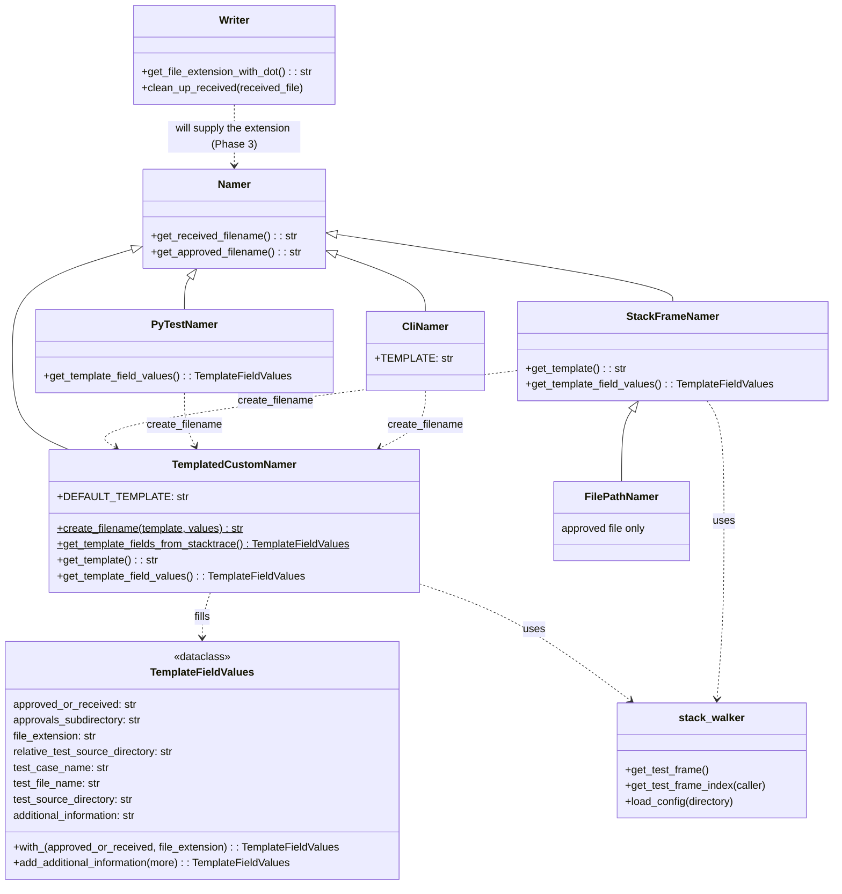

# Namer architecture

Every approved and received file name is built from one template. The template has named fields, and the namers only differ in how they fill those fields in.

- `TemplateFieldValues` holds the field values. `with_` sets approved/received and the extension. `add_additional_information` adds a ".more" part to the name.
- `TemplatedCustomNamer` owns `DEFAULT_TEMPLATE` and the static `create_filename`, which fills a template. It reads the fields from the stack through `stack_walker`.
- `StackFrameNamer`, `PyTestNamer` and `CliNamer` are thin shells: they only supply field values (and sometimes their own template) and let `create_filename` do the work. `FilePathNamer` is a `StackFrameNamer` that only changes the approved file.
- `Options.for_file.add_additional_information` is passed on by `Options.namer` to `get_default_namer`, which hands it to `StackFrameNamer`.
- The writer removes its own received file (`clean_up_received`) and knows its extension (`get_file_extension_with_dot`). For now `Options.namer` still sets the extension on the namer with `set_extension`; Phase 3 of the refactor moves it to the writer.

